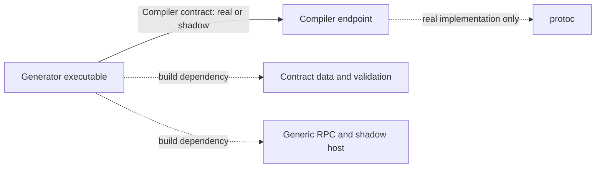

# First independent component experiment

The acceptance is independent implementation and verification, not the number of
Brick services. `brick-generator` now owns the actual descriptor-to-Rust generation
algorithm. Its dependency graph excludes `brick-compiler`, `brick-seed`,
`brick-runtime`, and `brick-cli`, including test and build dependencies.



The generator validates definition structure locally, asks its compiler dependency
for a descriptor, checks the returned schema identity and descriptor, generates Rust
message bindings, validates examples, and constructs the artifact. The compiler
adapter owns process execution and cleanup. The bootstrap bridge composes these
same libraries for the older CLI path. There is one generation algorithm.

## Runnable dependency replacement

Build the independent generator and the generic shadow host:

```sh
cargo build --locked -p brick-generator -p brick-rpc
target/debug/brick-shadow fixtures/compiler-shadow.bundle.json
```

Use the printed shadow port to launch the real generator:

```sh
target/debug/brick-generator \
  --contract fixtures/generate-bundle.bundle.json \
  --compiler-contract fixtures/compiler-shadow.bundle.json \
  --compiler-id deff59639a84888a8c1c8e493cac4f04b6236ffab3d43183ab75778f5d100215 \
  --compiler-address 127.0.0.1:SHADOW_PORT
```

Using a prebuilt bootstrap CLI and the generator's printed port:

```sh
target/debug/brick generate interfaces/echo.brick.toml \
  --via 127.0.0.1:GENERATOR_PORT \
  --contract fixtures/generate-bundle.bundle.json \
  --output .brick/echo-from-shadow-dependency.json
```

The shadow has one declared compiler response. A second invocation requires a new
shadow instance. Ctrl-C stops the owned services; the shadow exits unsuccessfully
if expectations were violated or not consumed. To use the real compiler instead,
build `brick-compiler`, run it with `--contract fixtures/compiler.bundle.json`, and
wire its printed address into the unchanged generator. The generator itself does
not require `protoc` on PATH in either configuration.

## Evidence identities

- `contract_id` hashes the exact authored schema bytes. It excludes cases,
  generated bindings, compiler identity and artifact packaging. It is conservative:
  even a schema comment change is an explicit new revision.
- `scenario_id` hashes serialized declared cases in order.
- The existing bundle digest still identifies the complete portable artifact.

The generator pins an accepted compiler contract revision in its implementation;
startup also validates the configured pin. Generic hosts check the requested
revision, and clients check the revision returned by the peer. This detects managed
peer configuration mismatches; self-reported metadata is not authentication or proof
of implementation behavior. The generic runtime remains loopback-only without an
OS sandbox. Full implementation/build identity and shared artifact-cache policies
remain future work.

## Frozen tests

`fixtures/compiler-shadow.bundle.json` supplies a known echo descriptor with an
explicit synthetic compiler identity. `fixtures/echo.bundle.json` is the reference
wire descriptor; `fixtures/generate-bundle.bundle.json` defines the generator's
interface. These are reviewed bootstrap artifacts, not live production evidence.
They were generated with the compiler identity recorded inside each bundle.

`brick-generator` tests use these files without regeneration or compiler dependencies.
They assert actual Rust output fields, run the resulting generated shadow, and reject
corrupted descriptors, wrong schema identities, unavailable dependencies, and changed
contract revisions. A schema rejection remains distinct from transport failure.
Scenario edits change scenario/artifact identity while preserving contract identity.

Changing a frozen fixture requires explicit regeneration and review; tests do not
silently rewrite their own expected inputs. Fixture bundles include generator/compiler
provenance but their hashes do not establish authenticity.

## Reproduce the bounded measurement

```sh
cargo build --locked -p brick-cli
python3 tools/isolation-experiment.py
```

The macOS script copies the current source into one ignored experiment snapshot,
builds the generator first, checks its Cargo artifact graph excludes the compiler,
and runs generator tests with an empty PATH. It then builds the compiler separately.
Two workers make synthetic disjoint source edits in that same snapshot. Per-worker
one-job limits bound concurrent compilation to two jobs. A later compiler-only edit
must leave every generator target fresh. The script finally swaps to the real
compiler endpoint and verifies the resulting generated output.

Reports include cold and warm build times, per-command maximum RSS reported by
`/usr/bin/time`, rebuilt targets, and allocated target-directory size. All processes
have bounded waits and owned cleanup. Evidence and build outputs stay under
`.local/isolation-*/`; the working checkout is not edited by the experiment.

Separate target directories prevent Cargo target locks from coupling the workers,
but duplicate dependency artifacts. This experiment demonstrates dependency/build
independence, not an efficient shared cache, a scheduler, peak host memory, or
100-agent throughput. Synthetic edits test invalidation scope, not feature complexity.

## Observed result: 2026-10-26

[Recorded evidence](evidence/component-isolation-2026-10-26.json), one local run:

| Operation | Elapsed | Scope |
| --- | ---: | --- |
| Cold generator build, including test binaries | 52.81 s | Generator, contract, RPC; no compiler adapter |
| Cold compiler build | 33.37 s | Compiler, contract, RPC |
| Generator edit while compiler worker runs | 3.06 s | Generator library/binary and isolation test only |
| Generator tests after edit, empty PATH | 0.11 s total | All test executables; real compiler unavailable |
| Generator build after compiler-only edit | 0.25 s | Zero targets rebuilt |
| Real compiler dependency swap: generation call | 0.14 s | Same generator executable |

Existing generator tests also passed while the compiler worker remained active
(the report records that worker's status after tests finished). These are two
workers with synthetic source edits, not 100 productive agents. The generator's
cold build reported a maximum RSS of about 388 MiB via `time`; this is not peak
combined machine memory. Allocated target directories were about 407 MiB for the
generator and 313 MiB for the compiler, about 721 MiB combined. The compiler-cache
wrapper was disabled for this experiment. No comparison with a cold bootstrap build
under identical conditions was performed.

Source manifests and final executable/toolchain identities were captured after the
run. The initial source manifest was reconstructed from the retained final snapshot
by removing the recorded synthetic edits. The report labels these limits; those
identities are not claimed as contemporaneous execution-time evidence. Future runs
of the harness save their initial source manifest, exact script and toolchain
before building.
